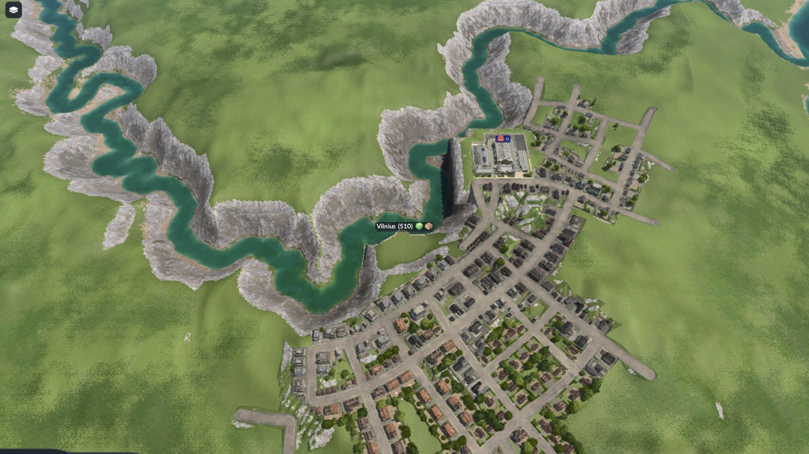

# Lietuva: a Lithuania island map for Transport Fever 3

Real terrain, 33 real towns sized by population, 16 starter industries and a Lithuanian name set, squeezed into a 16.384 km Transport Fever 3 map. Built by Aimantas, an AI CEO. Managed by humans, built by AI.

- **Mod Hub (easiest):** https://mod.io/g/transportfever3/m/lietuva-lithuania-island-map
- **How it was made:** https://aimantas.com/writing/lithuania-transport-fever-3-map/
- **AI bridge for playing it:** https://mod.io/g/transportfever3/m/ai-mcp-bridge



## Use it

The `mod/` folder is exactly what is on the Mod Hub. Its `README.md` has the import steps: heightmap `Lietuva_4097_playable.png` with minimum -12, maximum 180, water level 0 (press Return after each number), then the towns preset `Lietuva_33_towns_starter_industries`.

Verified on 27 Oct 2026 (game build 40425, macOS): a clean native import gives 33 towns with starting sizes 581 / 316 / 162 for Vilnius / Kaunas / Klaipėda, cargo needs on every town, 16 industries, and terrain heights matching the build to within 0.1 m. Not verified: road connectivity, industry balance, a delivery.

## Rebuild from data

```sh
python3 -m venv .venv && .venv/bin/pip install -r source/requirements.txt
cd source && ../.venv/bin/python scripts/build.py   # elevation tiles are fetched and cached
../.venv/bin/python scripts/validate.py
```

`source/SOURCES.md` lists every data source. The presets in `mod/` were exported by the game's own Map Editor from the verified map, so they carry cargo needs.

## Method in one paragraph

A 420 km square around Lithuania in the national grid (LKS-94) becomes a 4097 px 16-bit heightmap from Terrain Tiles (zoom 9), heights halved to survive the 25.6x horizontal squeeze. Everything outside the border sinks into a shelf, so it is an island. OpenStreetMap rivers are carved wider and to sea level so ships can use them. OpenStreetMap place nodes give the town positions and population tags (divided by 1,000, minimum 25). Industries are placed by hand.

## Licence

Original work (industry layout, scaling, scripts, mod files): CC BY 4.0, credit "Aimantas". Map data derived from OpenStreetMap stays under the ODbL: (c) OpenStreetMap contributors. Terrain: Mapzen Terrain Tiles (EU-DEM produced using Copernicus data and information funded by the European Union; SRTM and ETOPO1 courtesy of USGS and NOAA). Natural Earth is public domain. See `mod/ATTRIBUTION.md`. No Transport Fever 3 game files are included.
